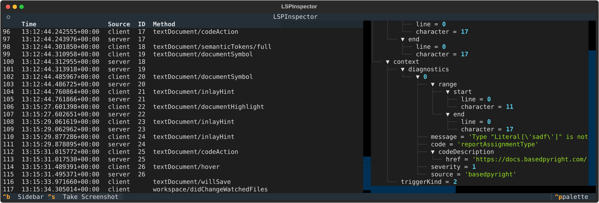

# Contributing

## AI Policy

This project does not accept any AI generated code.

Please also refrain from unnecessarily padding out your issues, comments or PR descriptions using LLMs. Though you may use AI to assist with translations if you aren't fluent in English.

If you are interested in the motivation behind this decision, [see here](https://detachhead.codeberg.page/workproperly/blog/2026/07/21/i-dont-like-ai/).

## Pull Requests

You may have noticed that creating PRs in this repository is restricted to collaborators only. This is an intentional barrier to entry intended to reduce the number of vibe-coded PRs I have to deal with (see the AI policy above.)

External contributions _are_ still welcome! You just have to follow these steps:

1. Ensure the change you want to make has an an open issue (if not, you may open one yourself)
2. Comment on the issue, tag me (`@detachhead`), asking me to assign it to you (note that I may want to discuss the issue further with you first)
3. Fork the repo and make your change **once the issue has been assigned to you**
4. Comment on the issue again letting me know when your branch is ready, and I'll make the PR on your behalf.

From there, the process is the same as it is in any other repo:

-   you'll still be able to push changes to your branch after the PR is created
-   the CI will still run against your changes
-   the merged commits will still be attributed to you (although it may make me a co-author)
-   I'll review your PR once it's ready

> [!NOTE]
> I am currently experimenting with this process so it's subject to change. If you have any questions, please open an issue.

## Github Issues

unlike the upstream pyright repo, we are very open to ideas for improvements and bug reports. if you've raised an issue on the upstream pyright repo that was closed without a solution, feel free to [raise it again here](https://github.com/DetachHead/basedpyright/issues/new).

please upvote issues you find important using the 👍 react. we don't close issues that don't get enough upvotes or anything like that. this is just to help us prioritize which issues to address first.

## Building

although pyright is written in typescript, in basedpyright we've made improvements to the developer experience for python developers who are not familiar with typescript/nodejs. you should be able to work on basedpyright without ever having to install nodejs yourself. the node installation is instead managed by a [pypi package](https://pypi.org/project/nodejs-wheel/) and installed to the project's virtualenv. the only thing you need to have installed already is python (any version >=3.9 should work)

we recommend using vscode, as there are project configuration files in the repo that set everything up correctly (linters/formatters/debug configs, etc).

1. hit `F1` > `Tasks: Run task` > `install dependencies`, or run the following command:
    ```
    ./gg.cmd uv sync
    ```
    this will install all dependencies required for the project ([gg](https://github.com/eirikb/gg), uv, node, typescript, etc.). all dependencies are installed locally to `./.venv` and `./node_modules`
2. press "Yes" when prompted by vscode to use the newly created virtualenv

you can now run any node/pnpm commands from inside the venv.

## Debugging

!!! note

    these instructions assume you are using VSCode/VSCodium. if you are using another editor, pnpm tasks can be run via the command line with `pnpm run script-name`. you can view all the available scripts in the root `./package.json`, but VSCode-specific debug configs will be unavailable.

### CLI

To debug pyright, open the root source directory within VS Code. Open the debug sub-panel and choose “Pyright CLI” from the debug target menu. Click on the green “run” icon or press F5 to build and launch the command-line version in the VS Code debugger. There's also a similar option that provides a slightly faster build/debug loop: make sure you've built the pyright-internal project e.g. with Terminal > Run Build Task > tsc: watch, then choose “Pyright CLI (pyright-internal)”.

### VSCode extension

To debug the VS Code extension:

1. Set `basedpyright.importStrategy` to `"useBundled"` in the project you plan to open in the second VS Code instance.
2. Select “Pyright extension” from the debug target menu.
3. Click on the green “run” icon or press F5 to build and launch a second copy of VS Code with the extension.
4. Within the second VS Code instance, open a python source file so the pyright extension is loaded.

To debug the VS Code extension in watch mode, you can do the above, but select “Pyright extension (watch mode)”. When pyright's source is saved, an incremental build will occur, and you can either reload the second VS Code window or relaunch it to start using the updated code. Note that the watcher stays open when debugging stops, so you may need to stop it (or close VS Code) if you want to perform packaging steps without the output potentially being overwritten.

!!! tip "inspecting LSP messages"

    Before launching the extension debug config, set `basedpyright.importStrategy` to `"fromEnvironment"` in the project you plan to open. While the VSCode extension is running in this mode, run the `npm: lsp-inspect` task to launch the [LSP inspector](https://lsp-devtools.readthedocs.io/en/latest/lsp-devtools/guide/inspect-command.html), which allows you to browse all messages sent between the client and server:

    

### Language server

you may want to debug the language server without the VSCode extension, which can be useful when investigating issues that only seem to occur in other editors. you can do this using [LSP-inspector](https://github.com/swyddfa/lsp-devtools)'s client by running the `npm: lsp-client` task or the "LSP client" launch config
